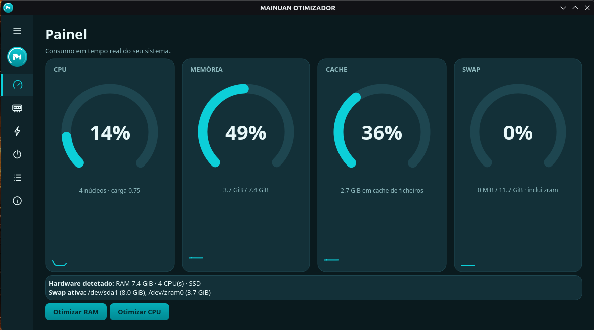
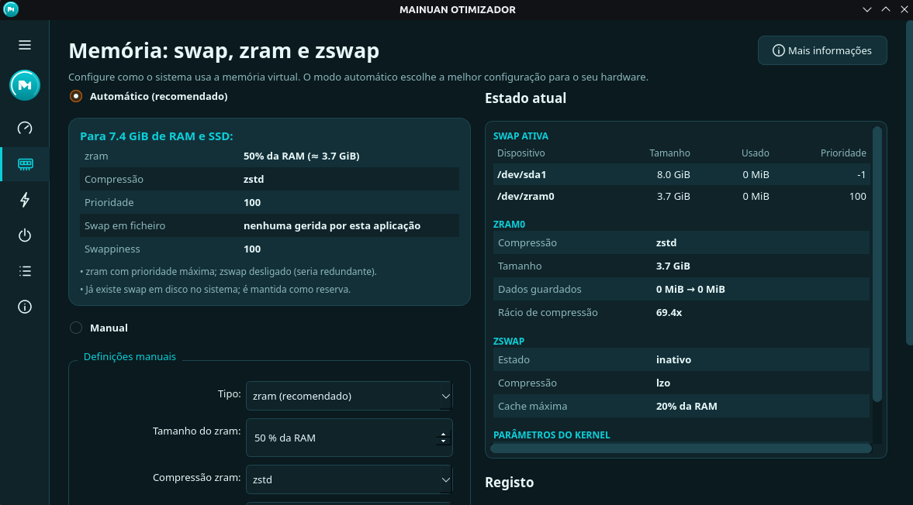

<div align="center">


# MAINUAN OTIMIZADOR


Aplicação gráfica para gerir **swap, zram e zswap** e otimizar o sistema Linux. Tem um modo automático que deteta a RAM e o tipo de armazenamento (SSD ou HDD) e aplica a configuração ideal, e mostra o consumo de CPU, memória, cache e swap em tempo real.

</div>

## Screenshots

<div align="center">
  
  
  
</div>

## Funcionalidades

- **Painel:** consumo em tempo real de CPU, memória, cache e swap, com o hardware detetado.
- **Memória (swap, zram e zswap):** modo **automático** (recomendado) ou **manual**, com tipo, tamanho, compressão e prioridade configuráveis. Mostra o estado atual e os parâmetros do kernel.
- **Otimizar RAM, CPU e navegador:** fecha processos inativos ou baixa-lhes a prioridade. Nada é fechado sem mostrar primeiro a lista.
- **Arranque:** desativar ou eliminar programas e serviços que iniciam com o sistema.
- **Processos:** lista de processos em execução.
- **Multilingue:** português (PT), inglês, espanhol, francês e português (BR).

## Requisitos

- Linux com **systemd** e **polkit** (`pkexec`)
- Python 3.10 ou superior
- PySide6 ou PyQt5
- Recomendados: `wmctrl`, `fonts-lato`

## Instalação

Descarrega o ficheiro `.deb` mais recente na página de [Releases](../../releases) e instala:

```bash
sudo apt install ./mainuan-otimizador_1_1_2.deb
```

Depois abre **MAINUAN OTIMIZADOR** no menu de aplicações, ou executa no terminal:

```bash
mainuan-otimizador
```

## Compilar o pacote a partir do código

```bash
git clone https://github.com/mainuan/mainuan-otimizador.git
cd mainuan-otimizador
dpkg-deb --root-owner-group --build package mainuan-otimizador_1_1_2.deb
```

## Estrutura do projeto

```text
mainuan-otimizador/
├── package/
│   ├── DEBIAN/              # control, postinst, prerm, postrm
│   └── usr/
│       ├── bin/             # executável de arranque
│       ├── lib/mainuan-otimizador/   # código Python (app, core, helper, i18n...)
│       ├── lib/systemd/system/       # serviço que reaplica a configuração de memória
│       └── share/           # .desktop, ícones, política polkit, copyright
├── assets/screenshots/
├── CHANGELOG.md
├── LICENSE
└── README.md
```

## Licença

Distribuído sob a licença **GPL-3.0 ou posterior**. Vê o ficheiro [LICENSE](LICENSE).

## Autor

**David Caixinha** — tugatechlaDC

## License

GPL-3.0 - See [LICENSE](LICENSE)

## 🆕 Nova Versão 1.1.2 (18 Novembro 2026)

## Contribuição

Report issues in [Issues](https://github.com/mainuan/mainuan-otimizador/issues)
and submit changes via pull request to the `main` branch. Every PR must pass the
[CI](https://github.com/mainuan/mainuan-otimizador/actions/workflows/ci.yml)
checks, which must all be green (passing). Document any visible changes in
[CHANGELOG.md](CHANGELOG.md) and `debian/changelog`.
