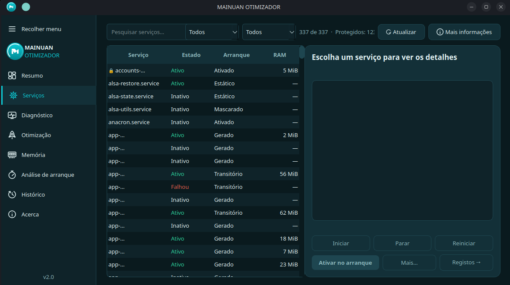
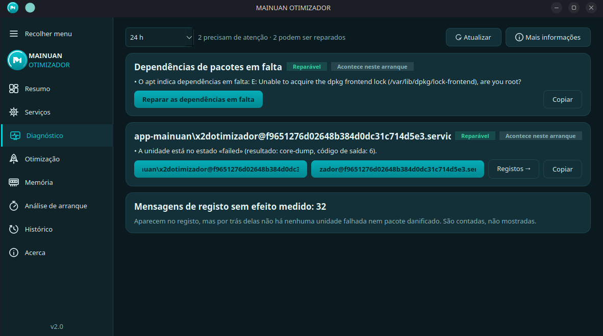
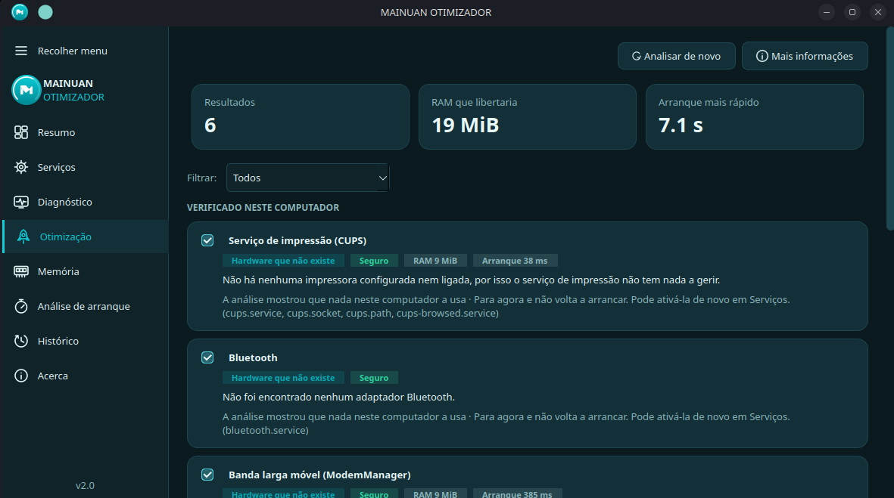
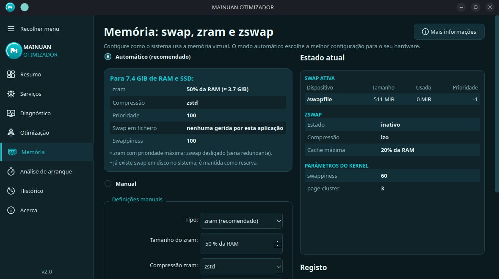
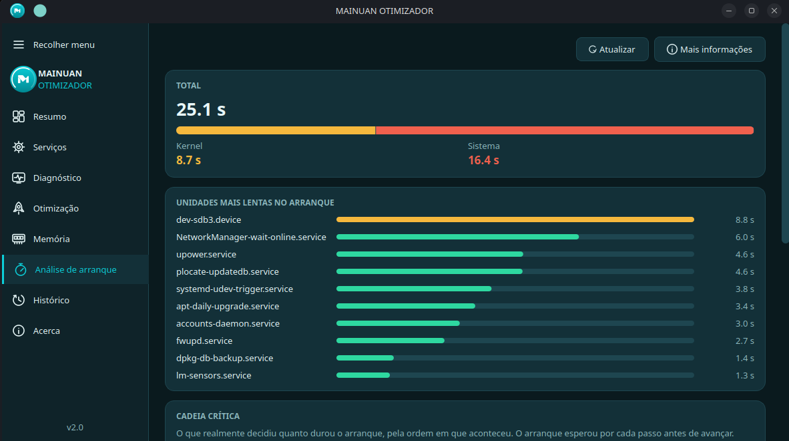
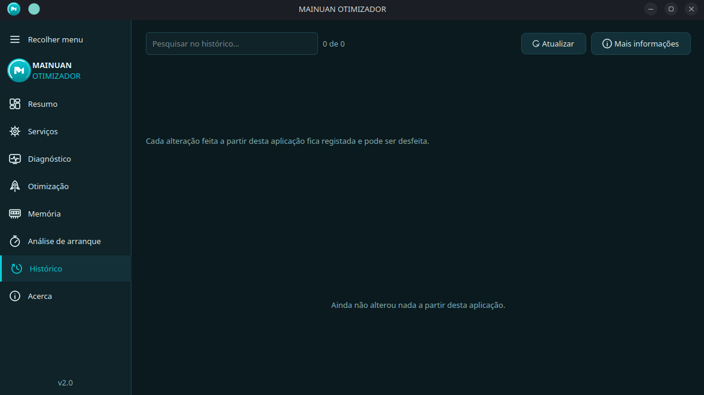

<div align="center">


# MAINUAN OTIMIZADOR


Aplicação para Linux (Ubuntu, Debian e derivados) que reúne num só sítio o estado do sistema, a gestão de serviços, o diagnóstico de erros, a otimização, a configuração de memória (swap, zram e zswap) e a análise do tempo de arranque.

</div>

## Screenshots

<div align="center">
  
  
  
  
  
  
  
  
</div>

** 🆕 Nova Versão: 2.0** - 2026-11-26

## Funcionalidades

| Menu | O que faz |
|---|---|
| **Resumo** | Vista rápida do sistema: serviços ativos, inativos e falhados, saúde geral, tempo de arranque, serviços que mais memória usam, atividade recente, dados do sistema e estado da memória. |
| **Serviços** | Lista todos os serviços do systemd (sistema e utilizador), com pesquisa e filtros. Permite iniciar, parar, reiniciar e ativar ou desativar no arranque, e mostra os detalhes de cada um. |
| **Diagnóstico** | Agrupa os erros do sistema, explica cada um e repara os que têm reparação possível: serviços falhados, pacotes danificados ou semi-configurados, ligações do systemd quebradas e entradas de arranque órfãs. |
| **Otimização** | Analisa o hardware e a configuração e propõe desativar serviços de que o computador não precisa (por exemplo, impressão sem impressora). Aplica a seleção toda de uma vez. |
| **Memória** | Gestão de swap, zram e zswap, com um modo automático que deteta a RAM e o tipo de armazenamento, e opção de repor os valores originais. |
| **Análise de arranque** | Tempo total e fases do arranque, unidades mais lentas, cadeia crítica, temporizadores frequentes e histórico dos últimos arranques. |
| **Histórico** | Registo das alterações feitas pela aplicação, com a opção de desfazer. |


## Segurança
 
- As alterações ao sistema passam por um único programa auxiliar, autenticado com o **pkexec**. Uma só palavra-passe cobre todo o lote de ações.
- Os serviços essenciais do sistema (por exemplo `dbus`, `systemd-*`, gestores de sessão e `NetworkManager`) estão **protegidos**: não podem ser parados, reiniciados nem desativados.
- Antes de qualquer reparação ou otimização, a aplicação mostra o que vai ser alterado e pede confirmação.
- As ações de reparação com o `apt` (reinstalar pacotes) precisam dos repositórios do sistema.
## Idiomas
 
Português (Portugal), Português (Brasil), Inglês, Espanhol e Francês. O idioma do sistema é detetado automaticamente. Se o sistema estiver noutro idioma, a aplicação usa Inglês.
 
## Requisitos
 
- Linux com **systemd**
- Python 3.10 ou superior
- PySide6 ou PyQt5
- pkexec (polkit)
## Instalação
 
Descarregue o ficheiro `.deb` da página de [Releases](../../releases) e instale:
 
```bash
sudo apt install ./mainuan-otimizador_2_0.deb
```
 
Depois abra a aplicação pelo menu de aplicações (MAINUAN OTIMIZADOR) ou pelo terminal:
 
```bash
mainuan-otimizador
```
 
## Remover
 
```bash
sudo apt remove mainuan-otimizador
```
 
Para remover também a configuração e a swap criada pela aplicação:
 
```bash
sudo apt purge mainuan-otimizador
```
 
## Compilar o pacote a partir do código
 
A pasta `package/` contém a árvore do pacote Debian. Para gerar o `.deb`:
 
```bash
dpkg-deb --build --root-owner-group package mainuan-otimizador_2_0.deb
```
 
## Estrutura do projeto
 
```
assets/screenshots/   capturas de ecrã
package/DEBIAN/       metadados e scripts do pacote
package/usr/          aplicação, ícones, atalho, serviço systemd e política polkit
CHANGELOG.md          histórico de versões
LICENSE               licença GPL-3.0
```

## Licença

Distribuído sob a licença **GPL-3.0 ou posterior**. Vê o ficheiro [LICENSE](LICENSE).

## Autor

**David Caixinha** — tugatechlaDC

## License

GPL-3.0 - See [LICENSE](LICENSE)

## Versão 1.1.2 (18 Novembro 2026)

## Contribuição

Report issues in [Issues](https://github.com/mainuan/mainuan-otimizador/issues)
and submit changes via pull request to the `main` branch. Every PR must pass the
[CI](https://github.com/mainuan/mainuan-otimizador/actions/workflows/ci.yml)
checks, which must all be green (passing). Document any visible changes in
[CHANGELOG.md](CHANGELOG.md) and `debian/changelog`.
